<p align="center">
  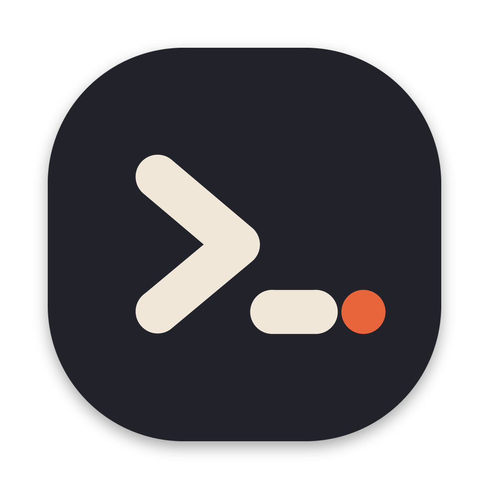
</p>

<h1 align="center">Shurikly</h1>

<p align="center">
  The open-source, local-first API client that reads your code.<br />
  REST, GraphQL, and WebSocket, with built-in AI, a mock server, and an MCP server. No accounts, no cloud.
</p>

<p align="center"><sub>A product of <strong>Wansify Ventures</strong></sub></p>

<p align="center">
  <a href="https://github.com/shurikly/shurikly/releases/latest">Download</a> ·
  <a href="#build-from-source">Build from source</a> ·
  <a href="CONTRIBUTING.md">Contributing</a> ·
  <a href="https://github.com/shurikly/shurikly/issues">Issues</a>
</p>

<p align="center">
  <a href="LICENSE"></a>
  <a href="https://github.com/shurikly/shurikly/actions/workflows/quality.yml"></a>
  <a href="https://github.com/shurikly/shurikly/releases/latest"></a>
</p>

## Screenshots

| | |
|---|---|
| 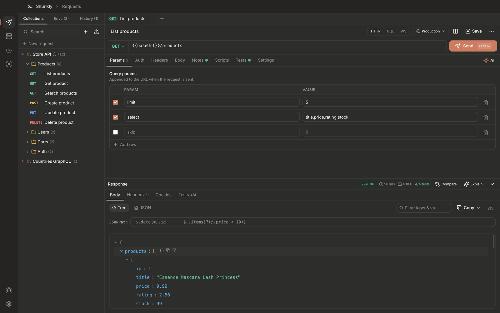 **Request editor** | 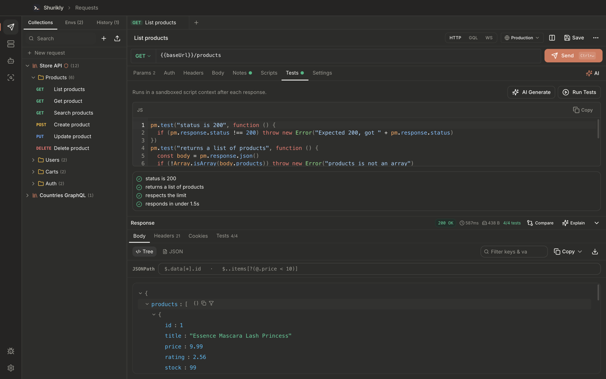 **Tests** |
| 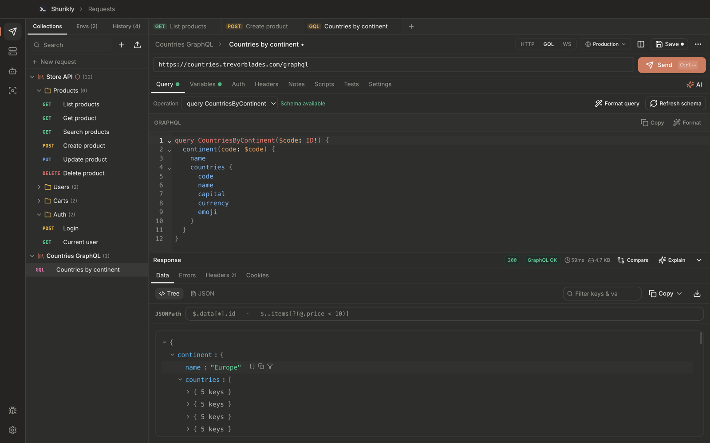 **GraphQL** | 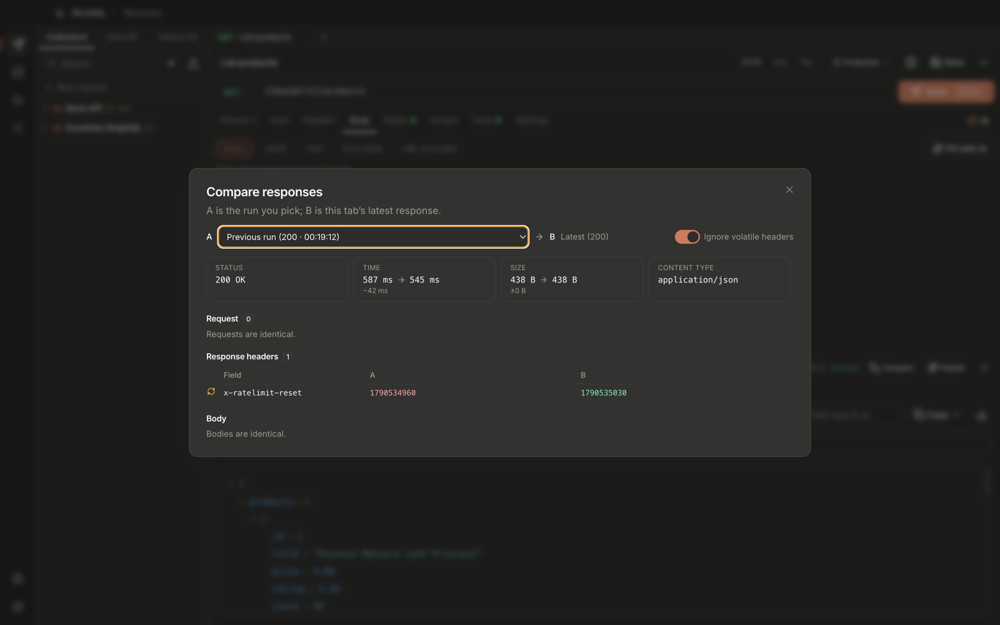 **Compare** |
| 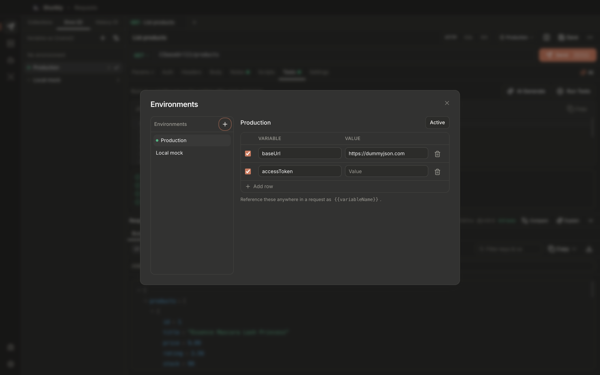 **Environments** | 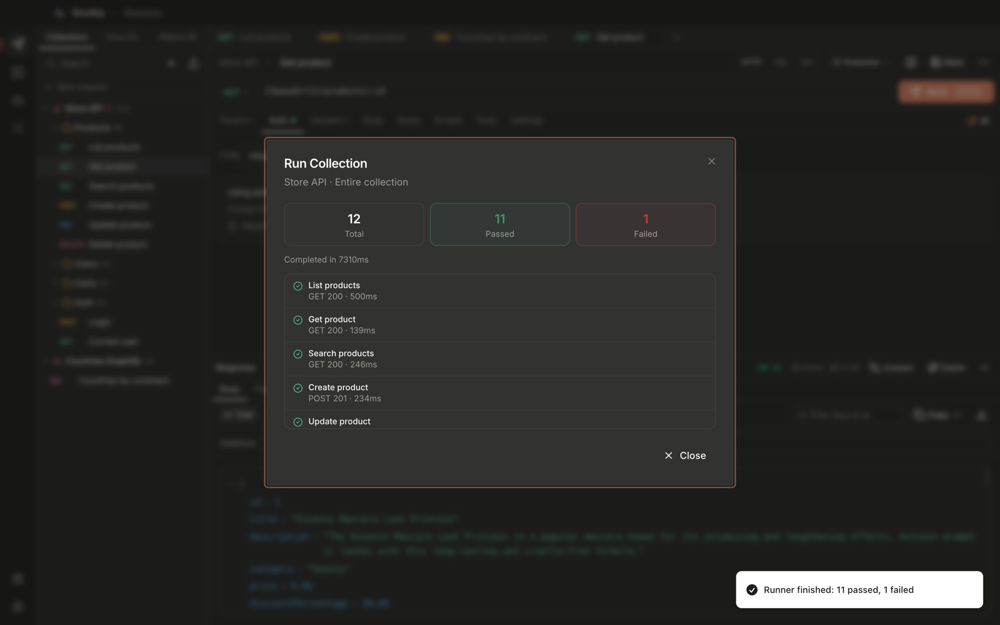 **Collection runner** |
| 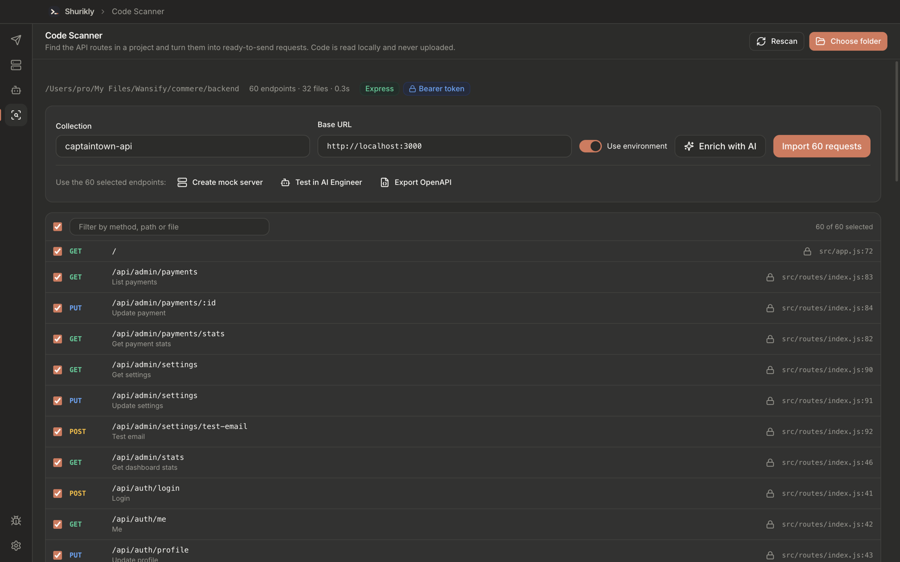 **Code Scanner** | 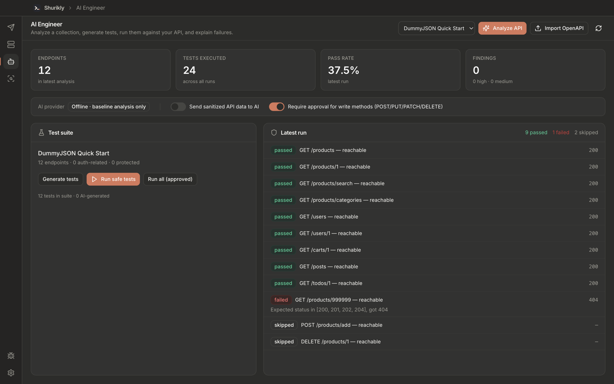 **AI Engineer** |
| 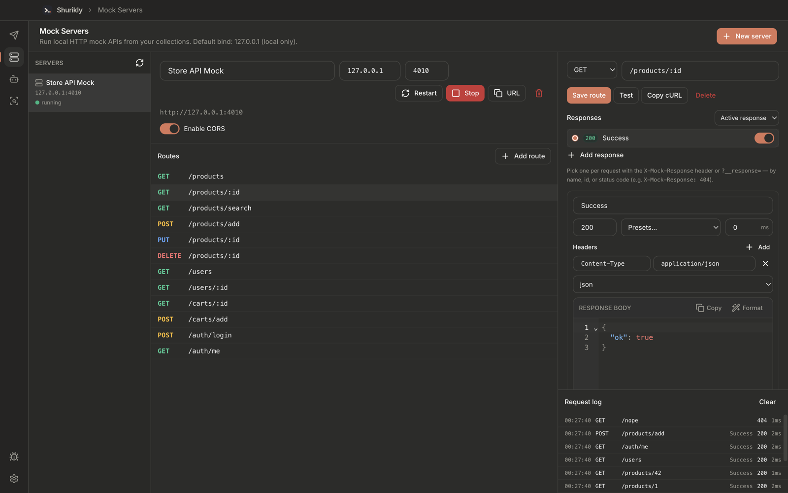 **Mock Server** | 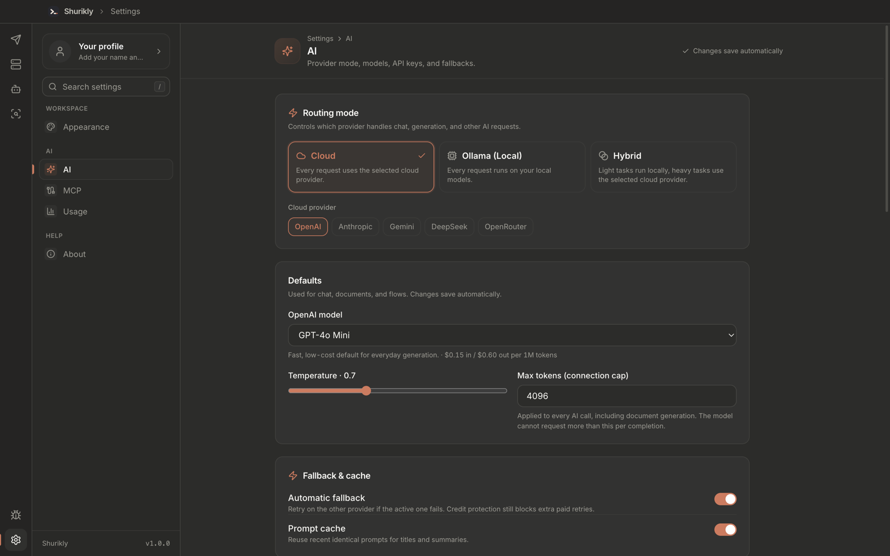 **AI settings** |
| 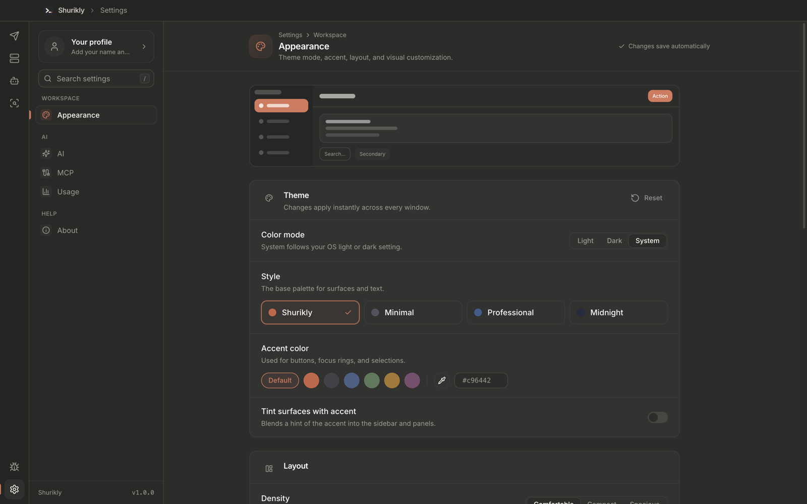 **Appearance** | 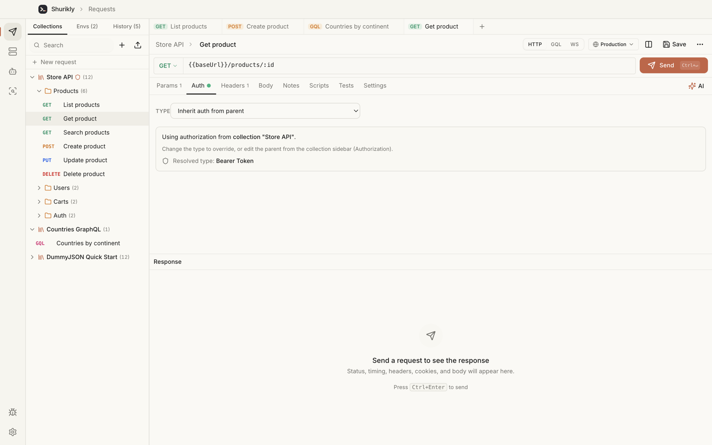 **Light theme** |

## Install

Download the installer for your platform from the
[latest release](https://github.com/shurikly/shurikly/releases/latest):

| Platform | File |
|---|---|
| macOS (Apple silicon / Intel) | `.dmg` |
| Windows 10 / 11 | `Setup .exe` |
| Linux | `.AppImage` |

Builds are not code-signed yet. On macOS, if the app is reported as damaged or from an
unidentified developer, move it to Applications and run
`xattr -cr /Applications/Shurikly.app` once. On Windows, choose **More info → Run anyway** in SmartScreen. On Linux,
`chmod +x Shurikly-*.AppImage` before running it.

## Features

- **Code Scanner**: scan a project folder, find the endpoints in your backend and frontend code, and turn them into a collection
- **Requests**: REST, GraphQL, and WebSocket, with params, headers, body (JSON, text, multipart form with files, URL-encoded), and auth (Bearer, Basic, API key, JWT, Digest, OAuth 1.0, OAuth 2.0, AWS Signature, Hawk)
- **GraphQL**: endpoint, query, variables, headers, and auth; schema introspection, schema-aware autocomplete and validation, operation selection, and a data/errors response view
- **Response inspection**: JSON tree with filter, JSONPath queries (`$..items[?(@.price < 10)]`), copy path/value, copy as JSON, find-in-body, save to file, large-response guards, and image/SVG/PDF/audio/video previews with a hex view for other binary bodies
- **Compare**: diff status, headers, JSON (path-level), text, response time, and size against the previous run, a pinned baseline, or another tab — including what changed in the request
- **Network**: system or custom HTTP/HTTPS proxy with auth and a bypass list, SSL verification on/off (globally or per request), custom CA files, the OS trust store, and client certificates (PEM or PFX) per host
- **Cookies**: a persistent cookie jar shared by requests, redirects, WebSockets, collection runs and MCP tools, with a cookie manager to view, edit and delete cookies by domain
- **WebSocket**: connections run in the main process, so custom headers, auth, cookies, the proxy and TLS settings apply
- **Collections**: folders, inherited auth and settings, request history, tabs
- **Git-friendly collection folders**: keep a collection as readable YAML files (one per request) in any folder, such as your repo. Edits are saved as you work, and changes from `git pull` or an editor are picked up live. Secret values never go into the files. See [Collection files](docs/COLLECTION_FILES.md)
- **Environments**: `{{variables}}` with per-environment values; mark a variable secret to keep its value on your machine
- **Scripts & tests**: pre-request scripts, assertions, and a collection runner with reports
- **Import / export**: import Postman, Insomnia (v4/v5), Bruno collection folders, HAR, OpenAPI and cURL, with format auto-detection and a summary of anything skipped; export Postman, OpenAPI, cURL, and Markdown/HTML API docs
- **Mock Server**: local HTTP mock APIs from collections (`127.0.0.1` by default), parameterized routes, multiple responses per route (status, headers, body, delay) chosen by active/sequential/random mode or per request via `X-Mock-Response`, examples saved from real responses, templates, CORS, and request logs
- **AI Engineer (Phase 1)**: analyze collections/OpenAPI, generate baseline (+ optional AI) tests, run via the existing request engine, failure analysis with evidence
- **AI**: generate requests from plain English, explain responses, write tests, fix failing requests, and document collections (OpenAI, Anthropic, Gemini, OpenAI-compatible, or local Ollama)
- **MCP**: a local server so Claude, Cursor, and other agents can list, edit, and send the requests in your live workspace
- **Bug reports**: built-in diagnostics page with recent logs

## Tech stack

Electron, React 19, TypeScript, Vite (electron-vite), TailwindCSS, Zustand, CodeMirror.

All HTTP traffic runs in the main process; the renderer talks to it over typed IPC
(`shared/ipc/api.ts`). Settings and AI usage are stored as JSON in the app's data folder;
API keys are encrypted with Electron `safeStorage`.

## Project layout

```
electron/
  main/
    api-studio/   HTTP client, auth, OAuth 2.0, scripts/tests, AI helpers
    ai/           AI providers, routing, metrics
    ai-engineer/  API analysis, test generation, failure analysis
    code-scanner/ project scanning and AI enrichment (extractors live in shared/lib/code-scanner)
    infra/        logger, API keys, onboarding, bug reports, JSON store, collection folders
    ipc/          IPC handlers
    mock-server/  local HTTP mock server runtime
    mcp/          local MCP server for Claude, Cursor, and other agents
    windows/      main window
  preload/        contextBridge API
src/
  modules/              api-studio (the API client UI), ai-engineer, code-scanner, mock-server
  features/             settings, AI settings, onboarding, diagnostics
  shared/               UI components, stores, utilities
shared/                 cross-process types and IPC contract
  lib/collection-files/ collection folder format: pure serialize/parse plus a Node fs adapter
tests/                  vitest
```

## Privacy

Everything stays on your machine. There is no account, sync service, analytics, or
telemetry. Requests go straight from your computer to the URLs you enter (or through the proxy you set). AI features
are off until you add your own provider key (or run a local model with Ollama), and
data is sent to that provider only when you trigger an AI action.

## Build from source

Requires Node.js 20+ and npm.

```bash
git clone https://github.com/shurikly/shurikly.git
cd shurikly
npm install
npm run dev
```

No environment variables or accounts are needed.

```bash
npm run verify   # typecheck + tests + build
npm run lint
npm run dist:mac # or dist:win / dist:linux — installers land in release/
```

## Documentation

- [Collection files](docs/COLLECTION_FILES.md)
- [AI Engineer](docs/AI_ENGINEER.md)
- [Mock Server](docs/MOCK_SERVER.md)
- [Developer guide](DEVELOPER_GUIDE.txt) — architecture, every feature's internals, storage, security, testing and releases
- [Changelog](CHANGELOG.md)

## Contributing

Bug reports, ideas, and pull requests are welcome. Read [CONTRIBUTING.md](CONTRIBUTING.md)
to get set up, and follow the [Code of Conduct](CODE_OF_CONDUCT.md). Report security
issues privately as described in [SECURITY.md](SECURITY.md).

## License

Shurikly is built and maintained by **Wansify Ventures** and released under the
[MIT License](LICENSE). © 2026 Wansify Ventures and Shurikly contributors.
