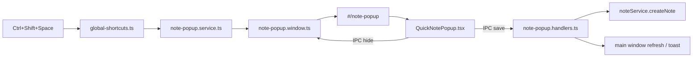

# Build Quick Note Popup (Ctrl+Shift+Space)

Mirror the existing Clipboard Quick Picker (`Ctrl+Shift+V`) so users can capture a note from **any app**, save it into Notepad, and close the popup cleanly.

## Goal

Press **Ctrl+Shift+Space** (macOS: **⌘⇧Space**) anywhere on the system → a small always-on-top popup appears near the cursor → type a note → **Save** stores it in Notepad → popup closes. Also support explicit close without saving.

---

## Requirement analysis

### What already exists

| Piece | Today | Relevance |
| --- | --- | --- |
| Clipboard quick picker | Global shortcut + frameless `BrowserWindow` + `#/clipboard-picker` | **Template** for window, shortcut, hide/show, IPC |
| Notepad module | Full CRUD via `noteService` / IndexedDB | **Persistence target** for saved notes |
| `Ctrl+Shift+N` | Focuses main window → `/notepad` | Keep as “open full Notepad”; popup is separate |
| Autosave (3s debounce) | Used by full editor | **Do not rely on this** in the popup — save must be immediate |

### User needs (mapped)

1. **Open from anywhere** — global OS shortcut, even when Workbench is in the background  
2. **Add note** — title + body in a compact popup  
3. **Save** — persist into existing Notepad storage; appear in Notepad list after save  
4. **Close** — Escape / X / Cancel; optional blur-hide (clipboard-style) with draft-loss protection  
5. **Easy to use** — few fields, keyboard-first, clear success feedback  

### Recommended UX defaults (decide once, then build)

| Decision | Recommendation | Why |
| --- | --- | --- |
| Shortcut | `CommandOrControl+Shift+Space` | Matches request; unused today |
| Toggle | Same shortcut hides if already open | Same as clipboard picker |
| Fields | Optional title + required body (plain text v1) | Fast capture; full editor stays in Notepad |
| Folder | Default “Inbox” / null folder; optional folder dropdown later | Keep v1 simple |
| Save shortcut | `Ctrl+Enter` / `⌘Enter` | Fast without mouse |
| Close | Escape, X button, Cancel | Explicit and familiar |
| Blur behavior | **Do not auto-hide if text is dirty**; hide only when empty or after save | Notes are typed content — blur-hide like clipboard would lose work |
| After save | Close popup + toast in main window if open | Confirm success without leaving user stranded |
| Sync | Broadcast `note:created` so open Notepad refreshes | Avoid stale list |

---

## Architecture (mirror clipboard picker)

### Layer responsibilities

1. **Main process** — register shortcut, create/show/hide popup window, IPC for save/hide  
2. **Preload / shared IPC** — typed channels for show, hide, save, created-event  
3. **Renderer popup route** — compact form UI only (no full Notepad chrome)  
4. **Existing notepad core** — reuse `noteService.createNote()`; no duplicate storage  

---

## Execution plan

### Phase 1 — Main-process popup shell

**Goal:** Shortcut opens/closes a dedicated frameless window like clipboard.

**Work**

- Add `electron/main/notepad/note-popup.window.ts` (clone `clipboard-popup.window.ts`)
  - Size ~420×360 (taller content area than clipboard list)
  - Frameless, always-on-top, skip taskbar, position near cursor
  - Load `#/note-popup`
- Add `electron/main/notepad/note-popup.service.ts`
  - `openQuickNote()` / `hideQuickNote()` / toggle
- Register in `global-shortcuts.ts`:
  - `quickNote: 'CommandOrControl+Shift+Space'`
  - Action → `notePopupService.openQuickNote()` (toggle)
- Wire lifecycle (create on app ready, destroy on quit) next to clipboard popup bootstrap
- Update `GLOBAL_SHORTCUT_LABELS` for settings/help UI if labels are shown there

**Done when:** Shortcut toggles an empty popup window from any app.

---

### Phase 2 — IPC + preload API

**Goal:** Popup can save and close safely; main Notepad can refresh.

**Work**

- Channels in `shared/ipc/channels.ts`, e.g.:
  - `NOTE_POPUP_HIDE`
  - `NOTE_POPUP_SAVE`
  - `NOTE_POPUP_SAVED` (main → main window / popup ack)
  - `NOTE_CREATED` (broadcast so Notepad store reloads)
- Types in `shared/ipc/api.ts`
- Handlers in `electron/main/ipc/note-popup.handlers.ts` (or extend notepad handlers)
  - Hide → `hideQuickNote()`
  - Save → validate → `noteService`/`noteManager.createNote` **from a path that works in main or via renderer bridge**
- Expose on `window.api` in preload

**Persistence note (important):** Today notes live in **renderer IndexedDB**. The clipboard picker persists in main-process JSON. For Quick Note, prefer one of:

- **Option A (recommended for v1):** Save from the **popup renderer** using existing `noteService` (same IndexedDB), then IPC-notify main window to refresh and hide window via IPC.  
- **Option B (later):** Move notepad storage to main/SQLite and save from main handlers.

Use **Option A** so we do not re-architecture storage in this feature.

**Done when:** Preload exposes hide/save; save creates a real note visible after opening Notepad.

---

### Phase 3 — Popup UI

**Goal:** Simple, keyboard-friendly capture form.

**Work**

- Route: `src/app/App.tsx` → `/note-popup` → `QuickNotePopupPage`
- Add path to `SKIP_PATHS` in `resolve-route-module.ts` (same as clipboard-picker)
- Component: `src/modules/notepad/ui/QuickNotePopup.tsx`
  - Header: “Quick Note” + Close (X)
  - Title input (optional)
  - Content textarea (autofocus)
  - Footer: Cancel | Save
  - States: idle / saving / error (inline message, not raw exception)
- Keyboard:
  - `Escape` → close (if dirty, confirm or keep open — prefer soft confirm only if non-empty)
  - `Ctrl/Cmd+Enter` → save
  - Tab order: title → content → Cancel → Save
- On open: clear form / focus content
- On save success: clear form → IPC hide → optional toast via main window
- On Cancel / X: hide without save (if dirty, confirm once)

**Visual:** Match clipboard picker chrome (frameless, compact, restrained accent) — not a full page layout.

**Done when:** User can type, save, and close entirely from the keyboard.

---

### Phase 4 — Notepad sync + polish

**Goal:** Notes saved from popup show up immediately where expected.

**Work**

- Main window listens for `NOTE_CREATED` → `notepad.store` reload / prepend note
- If Notepad page is open, list updates without manual refresh
- Settings / shortcut cheatsheet: document `Ctrl+Shift+Space`
- Empty validation: disable Save or show “Enter a note” when content is blank
- Trim whitespace; default title to first line or “Untitled note” if title empty (match existing `createNote` behavior)

**Done when:** Save from popup → note appears in Notepad list while app is open.

---

### Phase 5 — Verify

**Manual smoke**

- [ ] Shortcut works while another app is focused  
- [ ] Popup positions near cursor and stays on-screen  
- [ ] Save creates note; visible in Notepad  
- [ ] Escape / X / Cancel close without save  
- [ ] Dirty blur does not silently discard text  
- [ ] Toggle shortcut closes open popup  
- [ ] `Ctrl+Enter` saves and closes  
- [ ] Narrow / multi-monitor positioning looks correct  

**Automated (lightweight)**

- Unit/integration around save validation + IPC channel names if tests already cover clipboard IPC similarly  
- Skip Electron E2E unless the repo already has a harness  

---

## File touch list (expected)

| Area | Files |
| --- | --- |
| Shortcut | `electron/main/bootstrap/global-shortcuts.ts` |
| Window | `electron/main/notepad/note-popup.window.ts` (new) |
| Service | `electron/main/notepad/note-popup.service.ts` (new) |
| IPC | `shared/ipc/channels.ts`, `shared/ipc/api.ts`, preload, handlers |
| Route | `src/app/App.tsx`, `src/shared/lib/resolve-route-module.ts` |
| UI | `src/modules/notepad/ui/QuickNotePopup.tsx` (new) |
| Sync | `src/modules/notepad/stores/notepad.store.ts` (+ listener bootstrap) |

Reuse, do not duplicate: `noteService.createNote`, note types, Notepad storage engine.

---

## Out of scope (v1)

- Rich text / Markdown toolbar in the popup  
- Attachments, tags, pin from popup  
- Folder picker (add in v1.1 if needed)  
- Migrating IndexedDB → SQLite  
- Changing `Ctrl+Shift+N` behavior  

---

## Suggested build order (easy → hard)

1. Window + shortcut only (empty UI)  
2. Close path (Escape / X / IPC hide)  
3. Form UI + local validation  
4. Save via `noteService` in popup renderer  
5. Notify main Notepad to refresh  
6. Dirty-state / blur / confirm polish  
7. Smoke checklist  

---

## Acceptance criteria

- User can open Quick Note from **any application** with `Ctrl+Shift+Space`  
- User can write a note and **Save**; it appears in Notepad  
- User can **Close** without saving via Escape / X / Cancel  
- Popup does not silently lose typed text on accidental blur  
- Existing clipboard picker and full Notepad (`Ctrl+Shift+N`) keep working unchanged  
